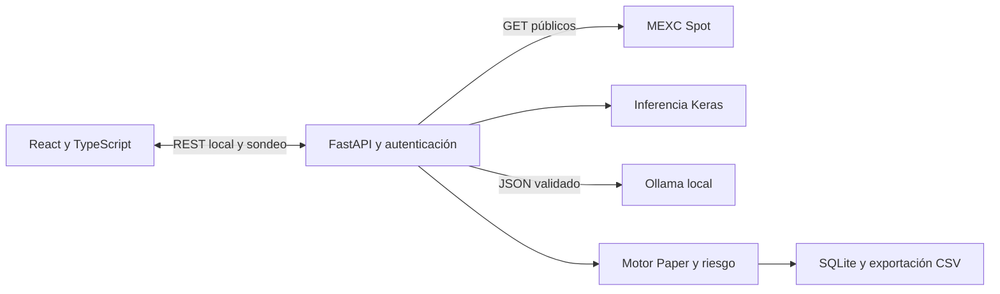
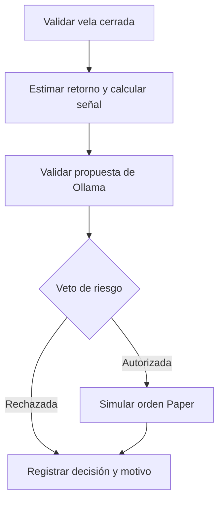

# Arquitectura y demostración

Juan Fernando Castrejón Villa · Matrícula 81901 · Gestión de Bases de Datos

## Arquitectura

El backend usa la interfaz pública de MEXC para consultar el mercado. El motor Paper simula las órdenes con saldo virtual. La sesión local se inicia con la clave configurada en `.env` y se conserva mediante una cookie HttpOnly.

## Flujo de decisión

La entrada long exige una señal superior al umbral del activo y el filtro de media móvil cuando está activo. El simulador calcula el tamaño con el límite de exposición por activo y valida la exposición agregada, la fecha y el estado del agente. La cartera replica spot con efectivo y posiciones largas. Una venta reduce una tenencia existente. En la estrategia base, la salida depende de la señal contraria. El replay liquida al final del tramo. El control del 3% de pérdida diaria pausa la cartera y es independiente del cierre de una posición.

## Rutas REST

Swagger UI está en `/docs` y el contrato OpenAPI en `/openapi.json`. Las rutas de aplicación que consultan o modifican estado usan autenticación local.

| Método y ruta | Función |
| --- | --- |
| GET `/api/health` | Estado Paper y bandera de órdenes reales |
| POST `/api/login` | Validar la clave e iniciar sesión |
| GET `/api/market/{symbol}` | Consultar datos de mercado |
| GET `/api/state` | Posiciones, decisiones, órdenes simuladas y eventos |
| GET `/api/lab/activity` | Consultar las etapas observadas del agente |
| GET `/api/llm/health` | Comprobar Ollama local |
| POST `/api/control/start`, `/pause` y `/stop` | Control manual del agente |
| POST `/api/replay/start` | Ejecutar un replay histórico |
| GET `/api/export/{table}` | Exportar la tabla autorizada |

El flujo de mercado valida datos antes de inferir. Las llamadas externas tienen tiempo límite y reintentos acotados. Una falla bloquea la propuesta o pausa el ciclo según el caso. Los rechazos se registran en la bitácora.

## Demostración de 10 minutos

| Minutos | Pantalla | Qué comprobar |
| --- | --- | --- |
| 0–2 | App local, **Control** | Estado Paper, Ollama y límites de riesgo. Abrir el mercado en vivo si MEXC está accesible. |
| 2–5 | **Oficina**, replay de BTCUSDT | Reproducir la primera compra archivada. Seguir vela, pronóstico, propuesta JSON, riesgo, orden Paper y registro. |
| 5–7 | **Oficina**, segundo ciclo y **Auditoría** | Mostrar el rechazo de otra compra por posición abierta y el motivo almacenado. |
| 7–9 | **Simulación** y **Laboratorio** | Comparar las tres estrategias del replay y generar reglas en el laboratorio histórico. |
| 9–10 | Cierre | Mostrar la evidencia CSV y explicar que la operación trazada proviene del replay fechado. |

La alternativa de respaldo es `Abrir_Casa_Juan_81901.html`. Abre la oficina sin instalación y permite recorrer los 30 ciclos archivados y reproducir el laboratorio. El estado en vivo depende del servicio local y de la conexión al mercado.
